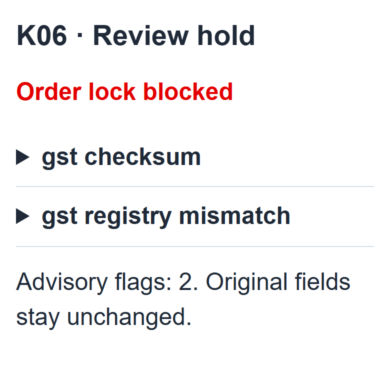

<p align="center">
  
</p>

<p align="center">
  <a href="https://github.com/AnkitKumar61/QuoteLock/actions/workflows/ci.yml"></a>
  
</p>

<p align="center"><strong>Telecom bundles an MSME owner can understand.<br>One saved quote from discovery to verification, acceptance and handoff.</strong></p>

<p align="center">
  <a href="#see-it-work">See it work</a> &nbsp; / &nbsp;
  <a href="#run-quotelock">Run locally</a> &nbsp; / &nbsp;
  <a href="#a-boundary-you-can-inspect">Architecture</a> &nbsp; / &nbsp;
  <a href="#show-the-work">Evidence</a> &nbsp; / &nbsp;
  <a href="docs/PRIVACY.md">Privacy</a>
</p>

---

## See it work

An owner chooses services in **Hindi or English**. Deterministic rules price the bundle. Add-ons create a new quote version. Evidence checks either clear the next step or leave an owned hold.

**Synthetic prototype:** the intent adapter is a rules-based stand-in. Registries, DigiLocker, e-sign, serviceability and payment mandates are mocked. The captures below come from the running app; the cover is concept artwork.

### Change the bundle. Accept the new version.

<p align="center">
  
</p>

**₹999 → ₹1,348/month** adds a business postpaid line. A new hash means **fresh acceptance after checks**. These are illustrative pre-tax catalogue midpoints, not published commercial offers.

### A hold explains itself. A tracker keeps the clocks separate.

<p align="center">
  
  &nbsp;&nbsp;
  
</p>

**K06 stays held.** The evidence conflict has a reason and an owner. Review cannot override a failed rule.

**Order locked ≠ service active.** Typical installation time begins at product readiness, never as a guarantee.

<details>
<summary><strong>Explore the mobile interface and partner queue</strong></summary>
<br>
<p align="center"></p>

Unresolved inquiries continue with a reason, an owner and a next action. Queue age is elapsed capture time, not a response promise.


</details>

## Run QuoteLock

**Python 3.11+ · Git · no API key**

The base demo uses recorded synthetic OCR fields. It needs no model download, paid service or Tesseract installation. Fresh uploads require Tesseract; [setup details](docs/SETUP.md).

<details open>
<summary><strong>Windows</strong> — PowerShell</summary>

```powershell
git clone https://github.com/AnkitKumar61/QuoteLock.git
cd QuoteLock
python -m venv .venv
.\.venv\Scripts\python.exe -m pip install -r requirements-dev.txt
.\.venv\Scripts\python.exe -m uvicorn quotelock.app:app --host 127.0.0.1 --port 8765
```

</details>

<details>
<summary><strong>macOS / Linux</strong> — terminal</summary>

```bash
git clone https://github.com/AnkitKumar61/QuoteLock.git
cd QuoteLock
python3 -m venv .venv
.venv/bin/python -m pip install -r requirements-dev.txt
.venv/bin/python -m uvicorn quotelock.app:app --host 127.0.0.1 --port 8765
```

</details>

Open **http://127.0.0.1:8765** · API explorer **http://127.0.0.1:8765/docs**

> Use localhost and synthetic documents only. Demo roles and ephemeral encryption keys do not provide production authentication or key management.

**Try the clinic journey:** load the synthetic clinic → see the quote → give consent → check **K02** → accept the current version → pass the explicit mock order gates → inspect the tracker.

<details>
<summary><strong>Other journeys and the four-persona replay</strong></summary>

Run `.\.venv\Scripts\python.exe -m quotelock.demo` on Windows or `.venv/bin/python -m quotelock.demo` on macOS/Linux.

| Journey | Intended outcome |
|---|---|
| Professional clinic, matching evidence | Mock order locked |
| Micro kirana, no GST | Preview; final evidence pending |
| Multi-site business | Specialist hold |
| K06 identifier conflict | Evidence hold |

Start a fresh inquiry for a new attempt. Locked orders are immutable. No-GST preview works; approved alternative final-identity evidence is still pending.

</details>

## A boundary you can inspect

### The AI never sees a price.

Only redacted, non-commercial intent reaches the current rules-based adapter. **Budget, prices, catalogue rows, quote cards, raw identifiers, contacts and order writes remain outside it.** Unknown text blocks the call; candidate slots cannot approve an offer.

| Step | Authority stays with |
|---|---|
| Discover a bundle | Structured facts, Hindi/English templates and catalogue rules |
| Price and revise | Deterministic arithmetic, eligibility, dependencies and immutable versions |
| Verify and lock | Consent, bound business identity, current acceptance and required gates |
| Continue an exception | A named owner and next action; no rule override |

<details>
<summary><strong>Open the six-node / nine-path architecture</strong></summary>
<br>


The diagram comes from [architecture.json](quotelock/architecture.json). A2 is the intent stand-in. Structured budget/facts bypass it. The final recheck requires matching identity, consent, clear evidence, current acceptance, known charges, serviceability and mocked payment/signature gates.

</details>

## Show the work

| Measured on synthetic inputs | Result | Read it honestly |
|---|---:|---|
| Unit, API and numeric tests | **448 passed** | Current status is linked in the CI badge. |
| Generated boundary trials | **0 leaks / 420** | **30% blocked**; no universal safety guarantee. |
| Automatic KYC core checks | **4 clear / 8 held** | **1 extra false hold**, 0 false passes versus team labels. |
| Exact GSTIN extraction | **5 / 11** | Identifier OCR remains a weakness. |
| Advisor scenarios | **15 / 15** | Team-written, not owner research. |
| Historical rule replay | **56 / 368 conflicts** | Includes 21 GST failures; categories overlap. |

<details>
<summary><strong>Reproduce the checks, inspect latency and read the assumptions</strong></summary>

Use the virtual-environment interpreter from the quickstart in place of `python` below (or activate that environment first):

```bash
python -m pytest analysis/test_numbers.py quotelock/tests -q -p no:cacheprovider
python analysis/numbers.py
python -m evaluation.business
python -m evaluation.measure
```

The original prefilled-request median/p90 were **2.84 / 4.26ms**; the fresh packaged check measured **4.86 / 7.60ms**, each over 100 requests. Neither clock includes owner typing/reading, OCR, a live model/network or installation. Re-running changes the receipt, not the frozen pitch automatically.

The 5,000-lead Base model projects 368 → about 440 activations and **₹1.63–2.92 lakh/month** added value. This is an assumed-effect/value-mix sensitivity, not demonstrated field lift. Professional comes first; Micro is a CAC-gated learning test. Its **₹8,088** ceiling is six months of starter revenue, not profit break-even. The proposed 90-day pilot validates process feasibility first; conversion remains directional pending a larger study.

[Release measurement](evaluation/release_evidence.json) · [Original evidence](evaluation/prototype_evidence.md) · [Business case](evaluation/business_case_evidence.md) · [Identity regression](evaluation/identity_binding_regression.md) · [Reference ledger](output/Final_Slide_Content_v4_SUPPORT.md)

</details>

## Find your way around

| Build | Inspect | Extend |
|---|---|---|
| [FastAPI app](quotelock/app.py) | [Privacy design](docs/PRIVACY.md) | [Contributing](CONTRIBUTING.md) |
| [Domain modules](quotelock/) | [Test suite](quotelock/tests/) | [Setup and fresh OCR](docs/SETUP.md) |
| [Mobile UI](quotelock/static/index.html) | [Source calculations](analysis/numbers.py) | [Known security limits](SECURITY.md) |
| [Synthetic fixtures](YTL_TrackA_Udyam_Digital_Data/README.md) | [Seven-slide content](output/Final_Slide_Content_v4.md) | [Release verification](docs/VERIFICATION.md) |

**Next:** owner research and process pilot · better identifier OCR · approved no-GST evidence · production authentication/keys/retention · evaluated live integrations and model · Marathi, voice and WhatsApp.

---

<p align="center"><strong>One saved quote. Clear authority.<br>An owner for every unresolved step.</strong></p>

<p align="center"><sub>Student prototype · Project Udyam Digital · Enterprise Track A<br>Fictional Accel Telecom data. No real customer outcomes or Airtel endorsement.<br><a href="NOTICE.md">Rights & attribution</a> · <a href="docs/README_ART.md">Cover artwork</a></sub></p>
