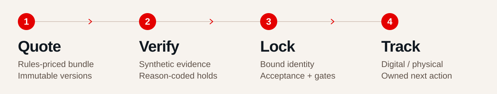
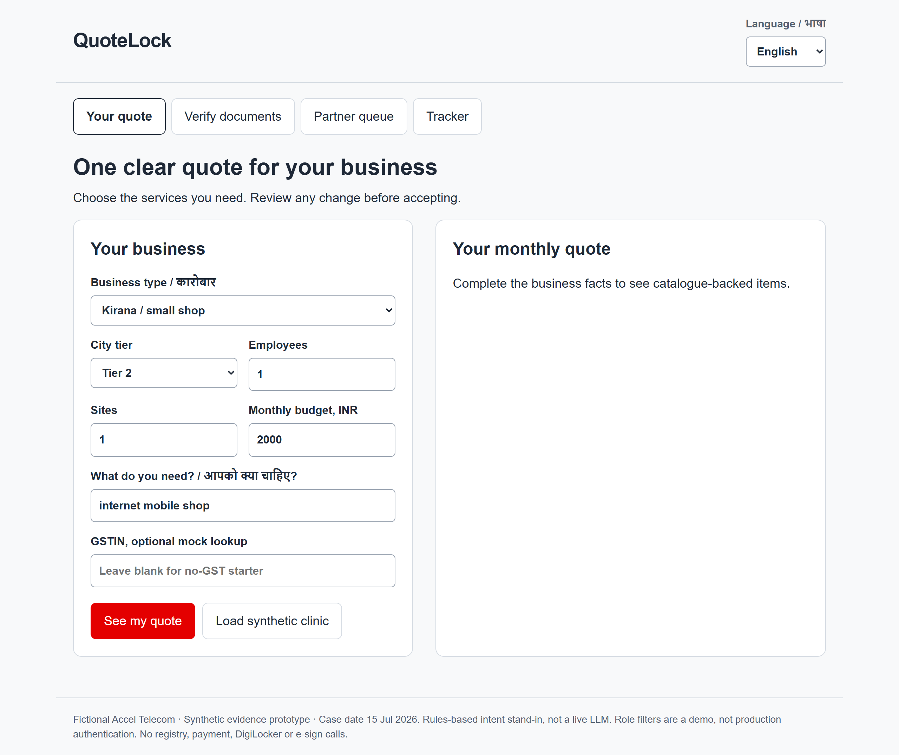

<p align="center">
  <a href="https://drive.google.com/file/d/1BmvIgrzNsKskJyHe_JqFBJEp4a4Newm1/view?usp=sharing" title="Watch the QuoteLock demo video on Google Drive">
    
    <picture>
      <source media="(max-width: 640px)" srcset="docs/assets/quotelock-demo-cta-mobile.svg">
      
    </picture>
  </a>
</p>

<p align="center"><strong>MSME bundle quoting, verification and order tracking</strong><br>Logging · VIT Vellore · Project Udyam Digital</p>

<p align="center">
  <a href="https://github.com/AnkitKumar61/QuoteLock/actions/workflows/ci.yml"></a>
  
</p>

<p align="center">
  <a href="#overview">Overview</a> ·
  <a href="#run-quotelock">Run locally</a> ·
  <a href="#interface-preview">Interface</a> ·
  <a href="#system-architecture">Architecture</a> ·
  <a href="#show-the-work">Validation</a> ·
  <a href="#presentation">Presentation</a>
</p>

## Overview

QuoteLock lets an MSME owner explore a telecom bundle in Hindi or English, review its price, verify evidence and accept the current quote version. Partners continue unresolved cases with a reason, an owner and a next action.

<picture>
  <source media="(max-width: 640px)" srcset="docs/assets/quotelock-journey-mobile.svg">
  
</picture>

> **Prototype scope.** This is a synthetic prototype. The intent adapter is a rules-based stand-in; registry lookups, DigiLocker, e-sign, serviceability and payment mandates are mocked. Prices, eligibility and order writes remain deterministic.

---

## Run QuoteLock

**Python 3.11+ · Git · no API key**

The base demo uses recorded synthetic OCR fields. It needs no model download, paid service or Tesseract installation. Fresh uploads require Tesseract; [setup details](docs/SETUP.md).

<details open>
<summary><strong>Windows</strong> — PowerShell</summary>

```powershell
git clone https://github.com/AnkitKumar61/QuoteLock.git
cd QuoteLock
python -m venv .venv
.\.venv\Scripts\python.exe -m pip install -r requirements-dev.txt
.\.venv\Scripts\python.exe -m uvicorn quotelock.app:app --host 127.0.0.1 --port 8765
```

</details>

<details>
<summary><strong>macOS / Linux</strong> — terminal</summary>

```bash
git clone https://github.com/AnkitKumar61/QuoteLock.git
cd QuoteLock
python3 -m venv .venv
.venv/bin/python -m pip install -r requirements-dev.txt
.venv/bin/python -m uvicorn quotelock.app:app --host 127.0.0.1 --port 8765
```

</details>

> Use localhost and synthetic documents only. Demo roles and ephemeral encryption keys do not provide production authentication or key management.

### Try the clinic journey

1. Load the **synthetic clinic** and see the quote.
2. Give consent and check packet **K02**.
3. Accept the **current quote version**.
4. Pass the explicit **mock order gates**.
5. Inspect the tracker.

<details>
<summary><strong>Other journeys and the four-persona replay</strong></summary>

Run `.\.venv\Scripts\python.exe -m quotelock.demo` on Windows or `.venv/bin/python -m quotelock.demo` on macOS/Linux.

| Journey | Intended outcome |
|---|---|
| Professional clinic, matching evidence | Mock order locked |
| Micro kirana, no GST | Preview; final evidence pending |
| Multi-site business | Specialist hold |
| K06 identifier conflict | Evidence hold |

Start a fresh inquiry for a new attempt. Locked orders are immutable. No-GST preview works; approved alternative final-identity evidence is still pending.

</details>

## Interface preview

<p align="center">
  <a href="docs/assets/ui_desktop.png"></a>
</p>

Recorded synthetic prototype captures: **[Open the desktop view](docs/assets/ui_desktop.png)** · **[Open the mobile view](docs/assets/ui_mobile.png)**.

## System architecture

The diagram follows the presentation's architecture and exception flow (pages 5–6), checked against the implementation. Boxes are logical modules in one FastAPI process, not separate deployed services.

**The AI never sees a price.** Prices, catalogue rows, quote cards, raw identifiers, evidence and write authority stay outside A2. Unknown text blocks the call. A clear packet alone cannot authorise an unbound quote, and review cannot override a failed rule.

<p align="center">
  <a href="docs/architecture/quotelock-system.svg"></a>
</p>

[Open full-size SVG](docs/architecture/quotelock-system.svg) · [Editable draw.io source](docs/architecture/quotelock-system.drawio) · [Architecture notes and reference mapping](docs/architecture/README.md)

<details>
<summary><strong>Explore the six modules and local storage</strong></summary>

| Module | Responsibility |
|---|---|
| **A1 · Consent and router** | Hindi/English input, consent and structured business facts. Budget bypasses the adapter. |
| **A2 · Intent adapter** | Redacted, non-commercial intent only. Rules-based today; a live LLM is future work. |
| **A3 · Rules engine** | Catalogue eligibility, dependencies, prices, contract terms and typical installation days. |
| **A4 · Quote versions** | Immutable content hashes and fresh acceptance when the bundle changes. |
| **A5 · Evidence checks** | Recorded packets or fresh OCR, local mock registries and reason-coded holds. |
| **A6 · Recheck and lock** | Bound identity, consent, current acceptance, required gates and the digital/physical tracker. |

SQLite stores quote versions, consent, holds, locks and encrypted evidence blobs. Vault keys and transient OCR fields remain process-local. Demo roles, retention operations and key management are not production controls; see [Privacy](docs/PRIVACY.md) and [Security](SECURITY.md).

</details>

## Show the work

| Measured on synthetic inputs | Result | Qualification |
|---|---:|---|
| Unit, API and numeric tests | **448 passed** | Current status is linked in the CI badge. |
| Generated boundary trials | **0 leaks / 420** | **30% blocked**; no universal safety guarantee. |
| Automatic KYC core checks | **4 clear / 8 held** | **1 extra false hold**, 0 false passes versus team labels. |
| Exact GSTIN extraction | **5 / 11** | Identifier OCR remains a weakness. |
| Advisor scenarios | **15 / 15** | Team-written, not owner research. |
| Historical rule replay | **56 / 368 conflicts** | Includes 21 GST failures; categories overlap. |

<details>
<summary><strong>Reproduce the checks, inspect latency and read the assumptions</strong></summary>

Use the virtual-environment interpreter from the quickstart in place of `python` below (or activate that environment first):

```bash
python -m pytest analysis/test_numbers.py quotelock/tests -q -p no:cacheprovider
python analysis/numbers.py
python -m evaluation.business
python -m evaluation.measure
```

The original prefilled-request median/p90 were **2.84 / 4.26ms**; the fresh packaged check measured **4.86 / 7.60ms**, each over 100 requests. Neither clock includes owner typing/reading, OCR, a live model/network or installation. Re-running changes the receipt, not the frozen pitch automatically.

The 5,000-lead Base model projects 368 → about 440 activations and **₹1.63–2.92 lakh/month** added value. This is an assumed-effect/value-mix sensitivity, not demonstrated field lift. Professional comes first; Micro is a CAC-gated learning test. Its **₹8,088** ceiling is six months of starter revenue, not profit break-even. The proposed 90-day pilot validates process feasibility first; conversion remains directional pending a larger study.

[Release measurement](evaluation/release_evidence.json) · [Original evidence](evaluation/prototype_evidence.md) · [Business case](evaluation/business_case_evidence.md) · [Identity regression](evaluation/identity_binding_regression.md) · [Reference ledger](output/Final_Slide_Content_v4_SUPPORT.md)

</details>

## Presentation

**[Open the final presentation — PDF](docs/presentation/QuoteLock_Logging_Final_v2.pdf)** · [Raw PDF / download](https://raw.githubusercontent.com/AnkitKumar61/QuoteLock/main/docs/presentation/QuoteLock_Logging_Final_v2.pdf)

Seven slides covering the acquisition funnel, segment economics, versioned quotes, architecture, operational ownership and pilot design. The supplied file is attached unchanged.

---

## Find your way around

| Area | Start here |
|---|---|
| **Application** | [FastAPI app](quotelock/app.py) · [Domain modules](quotelock/) · [Mobile UI](quotelock/static/index.html) |
| **Data and calculations** | [Synthetic fixtures](YTL_TrackA_Udyam_Digital_Data/README.md) · [Source calculations](analysis/numbers.py) |
| **Verification** | [Test suite](quotelock/tests/) · [Release verification](docs/VERIFICATION.md) |
| **Privacy and security** | [Privacy design](docs/PRIVACY.md) · [Known security limits](SECURITY.md) |
| **Setup and contributions** | [Setup and fresh OCR](docs/SETUP.md) · [Contributing](CONTRIBUTING.md) |

## Next steps

- Owner research and process pilot.
- Better identifier OCR and approved no-GST evidence.
- Production authentication, keys and retention.
- Evaluated live integrations and model.
- Marathi, voice and WhatsApp.

---

<p align="center"><strong>One saved quote. Clear authority.<br>An owner for every unresolved step.</strong></p>

<p align="center"><sub>Logging · VIT Vellore · Project Udyam Digital · Enterprise Track A<br>Fictional Accel Telecom data. No real customer outcomes or Airtel endorsement.<br><a href="NOTICE.md">Rights & attribution</a> · <a href="docs/README_ART.md">Artwork provenance</a></sub></p>
