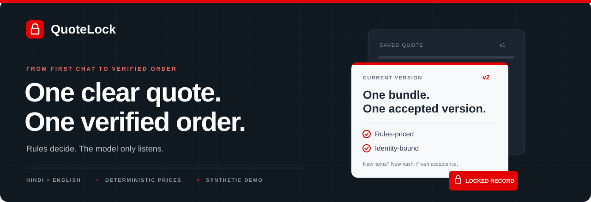
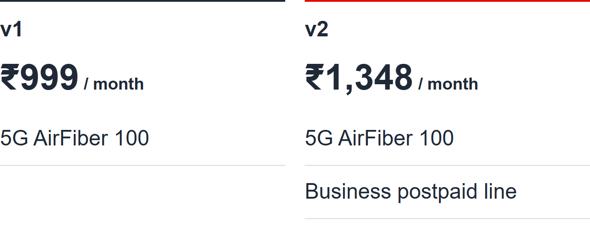
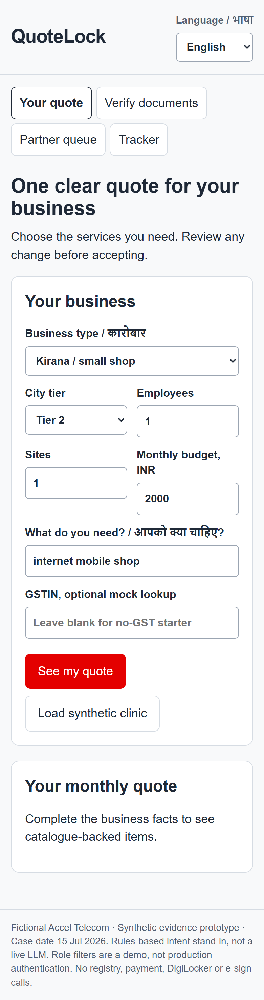
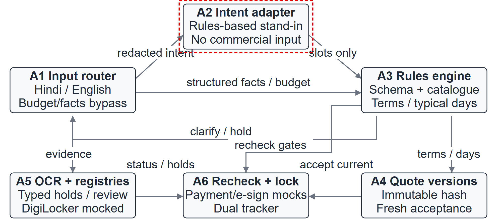
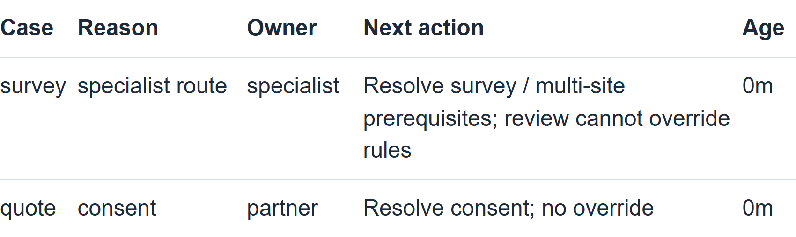
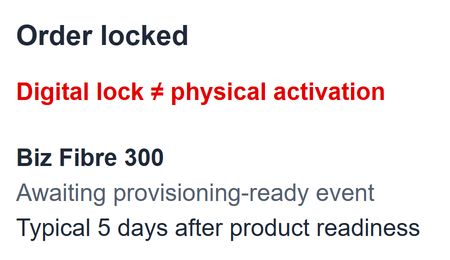

<p align="center">
  
</p>

<p align="center">
  <a href="https://github.com/AnkitKumar61/QuoteLock/actions/workflows/ci.yml"></a>
  
  
  
  
</p>

<p align="center"><strong>A telecom bundle an MSME owner can understand.<br>A quote that survives every handoff.</strong></p>

<p align="center">
  <a href="#run-it-locally">Run locally</a> ·
  <a href="#a-three-minute-walkthrough">Demo walkthrough</a> ·
  <a href="#the-authority-boundary">Architecture</a> ·
  <a href="#evidence-with-its-limits">Evidence</a> ·
  <a href="docs/PRIVACY.md">Privacy</a>
</p>

---

## From a conversation to an accountable order

QuoteLock is a phone-friendly prototype for small businesses buying a bundle of connectivity and workplace services. Owners describe their needs in Hindi or English, see one transparent monthly subtotal, change add-ons, verify evidence and accept the current quote. Partners receive unresolved work with a reason and a next action.

**The AI never sees a price. Rules decide; the model only listens.**

In this version, the intent adapter is a **rules-based stand-in**. Prices, eligibility, terms and order writes stay in deterministic code. Registry lookups, DigiLocker, e-sign, serviceability and payment mandates are **mocked**. All businesses, people, identifiers and documents are fictional Accel Telecom fixtures; no live customer outcome is claimed.

<table>
<tr>
<td width="50%"><strong>01 · Discover</strong><br>Hindi and English templates, structured business facts and a separate budget field.</td>
<td width="50%"><strong>02 · Price</strong><br>Catalogue rules, named products, toggleable add-ons and immutable quote versions.</td>
</tr>
<tr>
<td><strong>03 · Verify</strong><br>Consent, OCR, exact mock lookups and typed holds. Uncertainty stays visible.</td>
<td><strong>04 · Continue</strong><br>Current acceptance, identity binding, owned exceptions and a tracker with separate clocks.</td>
</tr>
</table>

## Change the bundle. Keep the record.

<p align="center">
  
</p>

The screenshot comes from the running prototype. Adding the business postpaid line changes the illustrative pre-tax subtotal from **₹999 to ₹1,348/month**. It creates a new content hash, and prior acceptance does not carry forward. Final acceptance follows evidence checks and the mock charge policy. These are catalogue midpoint illustrations, not published commercial offers.

<details>
<summary><strong>See the mobile interface</strong></summary>
<br>
<p align="center"></p>
</details>

## Run it locally

**Requirements:** Python 3.11+ and Git. The base demo and tests use committed extraction receipts; **no API key, model download, Tesseract installation or paid service is needed** for that path. Fresh image uploads and OCR regeneration require Tesseract separately.

```bash
git clone https://github.com/AnkitKumar61/QuoteLock.git
cd QuoteLock
python -m venv .venv
```

Activate the environment:

```powershell
# Windows PowerShell
.venv\Scripts\Activate.ps1
```

```bash
# macOS / Linux
source .venv/bin/activate
```

Then install and start:

```bash
python -m pip install -r requirements-dev.txt
python -m uvicorn quotelock.app:app --host 127.0.0.1 --port 8765
```

Open **http://127.0.0.1:8765**. Interactive API docs are at **http://127.0.0.1:8765/docs**.

> Keep this demo on localhost. Its role filters and ephemeral encryption key are demonstration mechanisms, not production authentication or key management. Do not upload real documents.

## A three-minute walkthrough

1. **Quote.** Select **Load synthetic clinic**, then **See my quote**. Review the professional bundle and its subtotal.
2. **Evidence.** Open **Verify documents**, give purpose consent and select **K02**. This packet clears the current core checks using recorded synthetic OCR fields.
3. **Accept and lock.** Accept the current version after checks and acknowledge the explicit mock charge, serviceability and first-payment gates. The order locks only when all required gates pass.
4. **Track.** Open **Tracker**. A digital lock is visible; physical products still await provisioning readiness. A lock is not an installation.
5. **Try a hold.** Start a new inquiry and try **K06**, or use the replay below. Checksum/lookup conflicts stay held and appear in the partner queue.

For the complete four-persona API replay:

```bash
python -m quotelock.demo
```

| Persona | Intended outcome |
|---|---|
| Professional clinic with matching evidence | Mock order locked |
| Micro kirana without GST | Preview; final evidence pending |
| Multi-site business | Specialist hold |
| K06 identifier conflict | Evidence hold |

A new opaque inquiry ID is created on a fresh session. Use a fresh session for a new attempt: an already locked order cannot be edited. No-GST preview is supported; an approved alternative final-identity workflow is still pending.

## The authority boundary

<p align="center">
  
</p>

| Component | Its authority |
|---|---|
| **Input router** | Separates structured facts/budget from free text; supports Hindi/English templates. |
| **Intent adapter** | Receives only redacted, non-commercial intent. Unknown text blocks the call. |
| **Rules engine** | Validates schema, catalogue eligibility, dependencies, prices, terms and typical days. |
| **Quote versions** | Stores immutable content hashes; a material change requires fresh acceptance. |
| **Evidence checks** | Validates source fields, uses mock registries and assigns owned holds. |
| **Recheck + lock** | Requires bound identity, current acceptance, consent, clear evidence, charges, serviceability and mock payment/signature gates. |

The adapter receives **no price, catalogue row, quote card, raw identifier, phone/email, budget or order-write access**. Its candidate slots cannot approve an offer. Review cannot override a failed rule.

## Evidence, with its limits

The recorded baseline was measured on synthetic inputs. Test counts are reproducible; latency is machine-specific. The CI badge reports the actual current workflow, rather than a manually painted passing status.

| Check | Recorded result | What it establishes |
|---|---:|---|
| Unit, API and numeric tests | **448 passed** | Tested catalogue arithmetic, gates, consent, versions, rule replay and regressions. |
| Generated boundary trials | **0 leaks / 420 utterances** | No payload leak on this generated distribution; **30% of calls blocked**. |
| Automatic KYC core checks | **4 clear / 8 held** | Actual OCR/policy outcome, not the expected answer substituted into extraction. |
| KYC versus team labels | **1 extra false hold; 0 false passes** | Small, adversarial specimen set; not a legal or general-accuracy guarantee. |
| Exact GSTIN extraction | **5 / 11 fields** | Identifier OCR is a current weakness and creates review work. |
| Advisor scenarios | **15 / 15 passed** | Team-written scenarios across four segments and two languages, not owner research. |
| Historical rule replay | **56 conflicts / 368 bundles** | Source catalogue/GST checks; categories overlap. |

Run the suite:

```bash
python -m pytest analysis/test_numbers.py quotelock/tests -q -p no:cacheprovider
```

Recompute the financial model or regenerate scripted evidence:

```bash
python analysis/numbers.py
python -m evaluation.business
python -m evaluation.measure
```

The original quote-request median/p90 were **2.84ms / 4.26ms**; the fresh packaged-environment check measured **4.86ms / 7.60ms**. Each used 100 already-filled scripted requests. Both clocks exclude owner typing/reading, OCR, live model/network and installation; neither measures end-to-end onboarding. See the separate [release measurement](evaluation/release_evidence.json), [original evidence ledger](evaluation/prototype_evidence.md), [business assumptions](evaluation/business_case_evidence.md) and [identity-binding regression](evaluation/identity_binding_regression.md).

<details>
<summary><strong>Fresh OCR instead of recorded extraction</strong></summary>
<br>

Install [Tesseract](https://tesseract-ocr.github.io/tessdoc/Installation.html) with English data, put `tesseract` on `PATH`, or set `TESSERACT_CMD` to its executable. No OCR engine binary is bundled here.

```bash
python -m quotelock.kyc.prepare
python -m quotelock.kyc.ocr_tesseract
python -m evaluation.measure
```

Preprocessing writes derivatives to the ignored `.data` directory. Runtime extraction never reads the team-labelled ground-truth fixture. Engine/data versions can change the result; report the actual output, including extra holds. The original recorded scan run used Tesseract 5.5.3 English fast data.

</details>

## Own the exception. Separate the clocks.

<table>
<tr>
<td width="65%"></td>
<td width="35%"></td>
</tr>
<tr>
<td><strong>Unresolved work has an owner.</strong><br>Specialists, partners and operations continue the saved quote. Queue age is elapsed capture time, not a response promise.</td>
<td><strong>Order locked ≠ service active.</strong><br>Typical install time begins at product readiness and is never a guarantee.</td>
</tr>
</table>

## The business case stays a hypothesis

In the unchanged **5,000-lead sensitivity model**, Base moves 368 historical activations to about 440 projected activations. Added monthly value is **₹1.63–2.92 lakh**, from starter prices to historical clean-ARPU mix. None of that lift was demonstrated by the prototype.

The proposed sequence is **Professional first; Micro as a CAC-gated learning test**. The ₹8,088 Micro cap is six months of starter revenue, not profit break-even. A 90-day pilot first checks process feasibility and safety; conversion remains directional until a larger controlled study. Full formulas, costs, stress cases and power assumptions are in [the business evidence](evaluation/business_case_evidence.md) and [the reference ledger](output/Final_Slide_Content_v4_SUPPORT.md).

## Repository map

```text
QuoteLock/
├── quotelock/                 FastAPI app and deterministic domain modules
│   ├── advisor/              Hindi/English templates and bundle selection
│   ├── boundary/             Fail-closed redaction and intent adapter
│   ├── catalogue/            Eligibility, dependencies and price arithmetic
│   ├── quote/                SQLite versions, hashes, consent and acceptance
│   ├── kyc/                  OCR, validation, fixtures and mocked services
│   ├── orders/               Final gates and durable idempotent lock
│   ├── tracker/              Separate digital and physical states
│   ├── backoffice/           Exception ownership
│   ├── static/               Mobile web UI and code-derived architecture
│   └── tests/                Unit and API tests
├── analysis/                 Source calculations and retained model baseline
├── evaluation/               Reproducible synthetic receipts and assumptions
├── YTL_TrackA_Udyam_Digital_Data/  Supplied fictional CSV/PNG fixtures
├── docs/                     Privacy, setup, demo and visual assets
├── output/                   Seven-slide Markdown source and used screenshots
└── .github/workflows/        Python test CI
```

## What is next

- [x] Versioned rules-priced bundles, consent, typed holds and mock order gates
- [x] Hindi/English templates, owned queue and dual tracker
- [x] Generated boundary tests and real specimen OCR evaluation
- [ ] Timed owner research and a process-feasibility pilot
- [ ] Better identifier OCR and an approved no-GST final-evidence path
- [ ] Production authentication, durable key management and complete retention operations
- [ ] Authorised live integrations and an evaluated language model
- [ ] Marathi, voice and WhatsApp journeys

## Project notes

Built for **Project Udyam Digital · Enterprise Track A** as a student hackathon prototype. It is not an Airtel product or an endorsement. The [fixture README](YTL_TrackA_Udyam_Digital_Data/README.md) explains the deliberately fictional identifiers. The original case PDF, slide template, installed binaries, virtual environments and live databases are not redistributed.

Read [Privacy](docs/PRIVACY.md), [Setup](docs/SETUP.md), [Contributing](CONTRIBUTING.md) and [Attribution](NOTICE.md). No open-source licence has been selected; third-party data and software retain their own rights.

<p align="center"><sub>One saved quote. Clear authority. An owner for every unresolved step.</sub></p>
